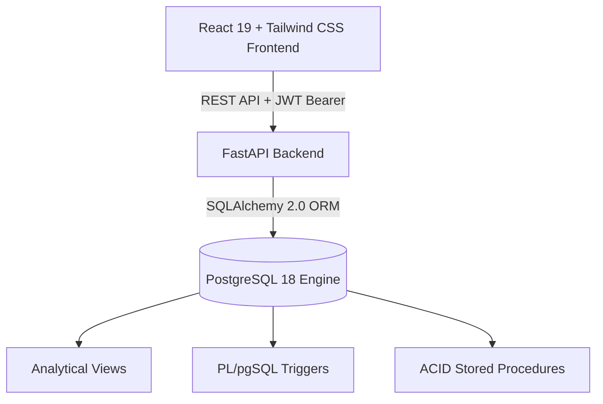

# 🏨 SmartHostel — Advanced Database Management System (DBMS)

[](https://www.postgresql.org/)
[](https://fastapi.tiangolo.com/)
[](https://react.dev/)
[](https://tailwindcss.com/)
[](https://opensource.org/licenses/MIT)

> A modern, relational-database-driven web application managing hostel allocations, room capacities, fee reconciliations, attendance tracking, and maintenance grievances. Built with **PostgreSQL 18**, **PL/pgSQL Triggers & Stored Procedures**, **FastAPI**, and **React 19**.

📖 **Looking for the exhaustive academic report? Read our [Comprehensive Project Report (PROJECT_REPORT.md)](./PROJECT_REPORT.md).**

---

## 🌟 Key Highlights & DBMS Features

- **Relational Integrity & 3NF/BCNF**: 21 normalized tables covering accommodation, finance, logistics, and personnel.
- **Automated PL/pgSQL Triggers**:
  - `trg_update_room_occupancy`: Dynamically manages room capacity counts and marks rooms `'FULL'` or `'AVAILABLE'`.
  - `trg_update_payment_status`: Automatically updates student fees to `'PAID'`, `'PARTIAL'`, or `'PENDING'` upon transaction insertion.
  - `trg_complaint_resolution`: Timestamps grievance resolution the instant tickets transition to `'RESOLVED'`.
- **ACID Transaction Functions**:
  - `allocate_room(student_id, room_id)`: Atomic room allocation eliminating double-booking race conditions.
  - `vacate_room(student_id)`: Safely checks out residents and restores bed availability.
- **Relational Views**: Pre-computed views (`available_rooms`, `hostel_occupancy`, `pending_fees`, `complaint_summary`) for rapid operational analytics.
- **Multi-Role Portals**: Distinct dashboards for **Administrator**, **Warden**, **Student**, and **Accountant**.
- **Unified & Cloud-Ready**: Single-command unified deployment, public HTTPS tunneling, and Azure / AWS cloud manuals.

---

## 🔑 Default Demo Credentials

All test accounts come pre-seeded with realistic data:

| Role | Username | Password | Key Responsibilities |
|---|---|---|---|
| **Admin** | `admin` | `admin123` | System-wide configuration, hostels, rooms, inventory, notices |
| **Warden (Boys)** | `warden_boys` | `warden123` | Room allocations, attendance, leave approvals, visitor passes |
| **Warden (Girls)**| `warden_girls` | `warden123` | Room allocations, attendance, leave approvals, visitor passes |
| **Accountant** | `accountant` | `acct123` | Fee structures, student payment tracking, defaulters ledger |
| **Student** | `sahaana` | `sahaana123` | Profile, room view, fees payment, leave pass requests, complaints |

---

## 🚀 Quick Start Guide

### 1. Prerequisites
- **Python 3.12+**
- **Node.js 18+** & npm
- **PostgreSQL 18** installed and running on port 5432

### 2. Installation
```bash
# Clone the repository
git clone https://github.com/Nethra-R368/dbms.git
cd dbms

# Create Python virtual environment
python -m venv venv
.\venv\Scripts\activate

# Install backend dependencies
pip install -r backend\requirements.txt

# Install frontend dependencies
cd frontend
npm install
cd ..
```

### 3. Database Configuration & Seeding
1. Copy `.env.example` to `.env`:
   ```bash
   cp .env.example .env
   ```
2. Update your PostgreSQL password inside `.env`.
3. Initialize the schema and populate sample data:
   ```bash
   python seed.py
   ```
   *This automatically creates the database, applies `schema.sql`, and seeds 100+ users, rooms, fees, and complaints.*

### 4. Running Locally
Run the all-in-one launcher:
```cmd
start_full_app.bat
```
- **Web App (Frontend)**: [http://localhost:5173](http://localhost:5173)
- **API & Swagger Docs**: [http://localhost:8000/docs](http://localhost:8000/docs)

---

## 📦 Production & Deployment Scripts

| Script | Purpose |
|---|---|
| `start_full_app.bat` | Launches PostgreSQL, FastAPI backend, and React dev server locally. |
| `build_unified.bat` | Compiles React app into `backend/static` for single-server production serving. |
| `launch_online_link.bat` | Spawns a secure public HTTPS tunnel link for remote sharing & live demos. |
| `check_db_status.py` | Diagnostic script printing live row counts for all database tables. |
| `test_all_logins.py` | Diagnostic script validating JWT token generation across all roles. |

For enterprise cloud deployment on **Microsoft Azure** or **Amazon Web Services (AWS)**, refer to:
- 📘 [AZURE_POSTGRES_SETUP.md](./AZURE_POSTGRES_SETUP.md)
- 📙 [AWS_POSTGRES_SETUP.md](./AWS_POSTGRES_SETUP.md)

---

## 🏗️ System Architecture



---

## 📄 License
This project is open-source under the [MIT License](LICENSE).
