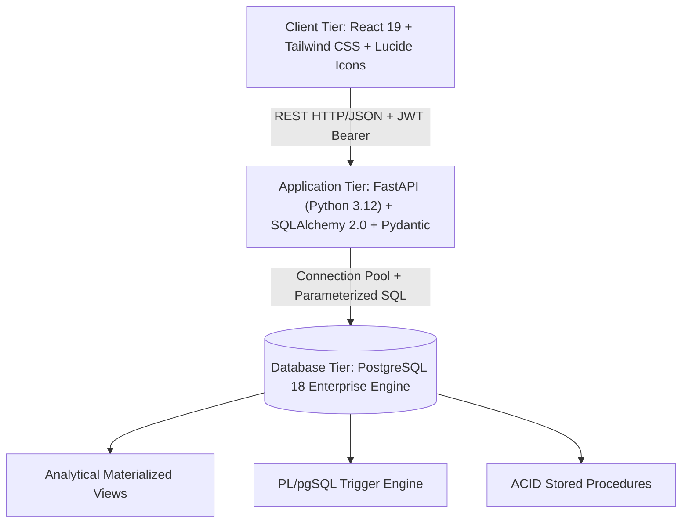
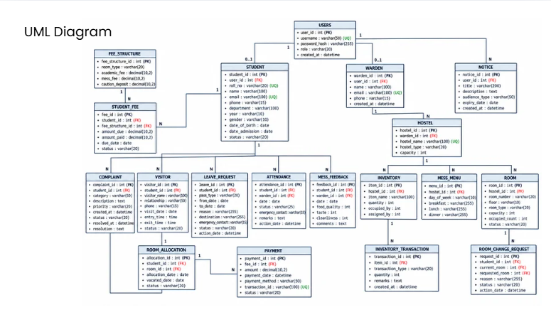
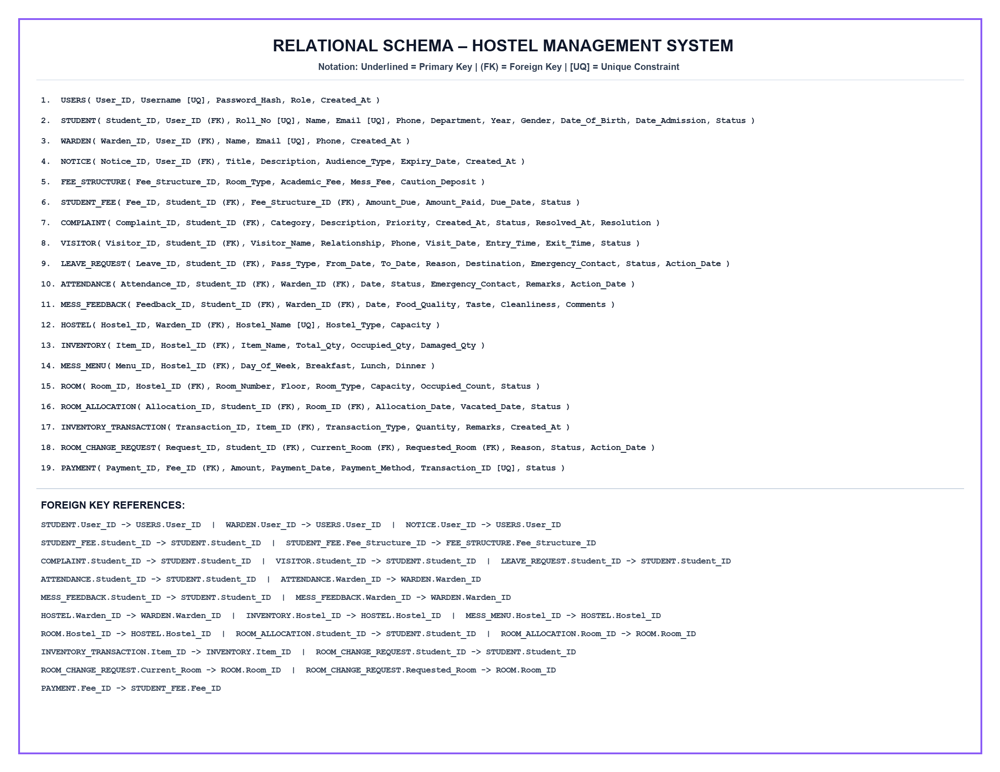

# 🏨 ResiKeep (SmartHostel) — Enterprise Relational Database Management System

[](https://www.postgresql.org/)
[](https://fastapi.tiangolo.com/)
[](https://react.dev/)
[](https://tailwindcss.com/)
[](https://github.com/Nethra-R368/dbms)
[](https://github.com/Nethra-R368/dbms)

> **23AIE303 – Database Management Systems | Final Project Evaluation**  
> GitHub Repository: [https://github.com/Nethra-R368/dbms](https://github.com/Nethra-R368/dbms)  
> Submission Package: `B12_TEAM12_SMARTHOSTEL.zip` (Alias: `B12_G12_SMARTHOSTEL.zip`)  
> Comprehensive Report PDF: [`ResiKeep_DBMS_Project_Report.pdf`](./ResiKeep_DBMS_Project_Report.pdf)  
> Final Presentation PPT: [`SmartHostel_Final_Presentation.pptx`](./SmartHostel_Final_Presentation.pptx)  

---

## 👥 1. Team Members & Course Details

- **Course**: 23AIE303 – Database Management Systems
- **Batch / Group**: Batch 12 / Group 12
- **Members**:
  1. **R Nethra** — Roll No: `CB.SC.U4AIE24147` (Department of AI & Data Science)
  2. **Sahaana Shri S K** — Roll No: `CB.SC.U4AIE24149` (Department of AI & Data Science)

---

## 📋 2. Project Overview & Problem Statement

### Overview
Modern higher education campus housing operations face severe bottlenecks due to fragmented manual record-keeping, spreadsheet synchronization discrepancies, billing mismatches, unmonitored curfews, and maintenance delays. **ResiKeep (SmartHostel)** is an enterprise multi-tenant relational housing management system engineering full data integrity across student records, room allocations, financial ledgers, biometric attendance logs, catering feedback, and maintenance tickets.

### Core Problem Statement
- **Double Allocation Anomalies**: Concurrent race conditions when assigning beds to arriving students.
- **Financial Reconciliation Gaps**: Uncorrelated partial fee installments causing audit discrepancies.
- **Curfew & Safety Tracking Gaps**: Disconnected gate logs and paper-based visitor registers.
- **Maintenance Latency**: Lost grievance tickets without accountability or timestamped audit logs.

### Solution Architecture
An ACID-compliant relational PostgreSQL database engine with PL/pgSQL stored procedures, triggers for atomic state transitions, parameterized ORM operations, and a modern reactive UI.

---

## 🏗️ 3. System Requirements & Architecture

### 3-Tier Enterprise Architecture


### System Requirements
- **Database Engine**: PostgreSQL 18+ (Port 5432)
- **Backend Runtime**: Python 3.12+ (FastAPI, Uvicorn, psycopg2-binary, SQLAlchemy, Pydantic)
- **Frontend Runtime**: Node.js 18+ / 24+ & npm (React 19, Vite, Tailwind CSS)
- **Tunneling / Remote Access**: OpenSSH / Cloudflare Tunnel / Bore

---

## 🧩 4. ER Diagram & UML Diagram

### UML Class Hierarchy
The structural class diagram details entity relationships, attributes, primary keys (`PK`), foreign keys (`FK`), and unique constraints (`UQ`) across 19 core tables:



### Key Entity Cardinalities
- `USERS` (1) — (0..1) `STUDENT` / `WARDEN`
- `HOSTEL` (1) — (N) `ROOM`, `INVENTORY`, `MESS_MENU`
- `STUDENT` (1) — (N) `ROOM_ALLOCATION`, `ATTENDANCE`, `COMPLAINT`, `VISITOR`, `LEAVE_REQUEST`, `MESS_FEEDBACK`
- `STUDENT_FEE` (1) — (N) `PAYMENT`
- `FEE_STRUCTURE` (1) — (N) `STUDENT_FEE`

---

## 🗄️ 5. Relational Schema Mapping

```
1.  USERS(User_ID, Username [UQ], Password_Hash, Role, Created_At)
2.  STUDENT(Student_ID, User_ID (FK), Roll_No [UQ], Name, Email [UQ], Phone, Department, Year, Gender, Date_of_Birth, Date_Admission, Status)
3.  WARDEN(Warden_ID, User_ID (FK), Name, Email [UQ], Phone, Created_at)
4.  NOTICE(Notice_ID, User_ID (FK), Title, Description, Audience_Type, Expiry_Date, Created_at)
5.  FEE_STRUCTURE(Fee_Structure_ID, Room_Type, Academic_Fee, Mess_Fee, Caution_Deposit)
6.  STUDENT_FEE(Fee_ID, Student_ID (FK), Fee_Structure_ID (FK), Amount_Due, Amount_Paid, Due_Date, Status)
7.  COMPLAINT(Complaint_ID, Student_ID (FK), Category, Description, Priority, Created_at, Status, Resolved_at, Resolution)
8.  VISITOR(Visitor_ID, Student_ID (FK), Visitor_Name, Relationship, Phone, Visit_Date, Entry_Time, Exit_Time, Status)
9.  LEAVE_REQUEST(Leave_ID, Student_ID (FK), Pass_Type, From_Date, To_Date, Reason, Destination, Emergency_Contact, Status, Action_Date)
10. ATTENDANCE(Attendance_ID, Student_ID (FK), Warden_ID (FK), Date, Status, Emergency_Contact, Remarks, Action_Date)
11. MESS_FEEDBACK(Feedback_ID, Student_ID (FK), Warden_ID (FK), Date, Food_Quality, Taste, Cleanliness, Comments)
12. HOSTEL(Hostel_ID, Warden_ID (FK), Hostel_Name [UQ], Hostel_Type, Capacity)
13. INVENTORY(Item_ID, Hostel_ID (FK), Item_Name, Total_Qty, Occupied_Qty, Damaged_Qty)
14. MESS_MENU(Menu_ID, Hostel_ID (FK), Day_of_Week, Breakfast, Lunch, Dinner)
15. ROOM(Room_ID, Hostel_ID (FK), Room_Number, Floor, Room_Type, Capacity, Occupied_Count, Status)
16. ROOM_ALLOCATION(Allocation_ID, Student_ID (FK), Room_ID (FK), Allocation_Date, Vacated_Date, Status)
17. INVENTORY_TRANSACTION(Transaction_ID, Item_ID (FK), Transaction_Type, Quantity, Remarks, Created_at)
18. ROOM_CHANGE_REQUEST(Request_ID, Student_ID (FK), Current_Room (FK), Requested_Room (FK), Reason, Status, Action_Date)
19. PAYMENT(Payment_ID, Fee_ID (FK), Amount, Payment_Date, Payment_Method, Transaction_ID [UQ], Status)
```



---

## ⚙️ 6. Normalization & Functional Dependencies

Every relation in the schema has been mathematically verified to satisfy **3NF and Boyce-Codd Normal Form (BCNF)**:

1. **First Normal Form (1NF)**:
   - All attributes contain strictly atomic, scalar values (no composite multi-valued fields or repeating nested arrays).
2. **Second Normal Form (2NF)**:
   - Every relation possesses a single surrogate primary key (e.g., `Allocation_ID`, `Fee_ID`, `Student_ID`).
   - Zero partial functional dependencies exist ($X \to Y$ where $X \subset PK$).
3. **Third Normal Form (3NF)**:
   - Eliminates transitive dependencies ($A \to B \to C$). For instance, room fee costs are isolated to `FEE_STRUCTURE(Fee_Structure_ID, Room_Type, Academic_Fee...)` rather than redundantly duplicating financial rates inside individual `ROOM` records.
4. **Boyce-Codd Normal Form (BCNF)**:
   - In every non-trivial functional dependency $X \to Y$, determinant $X$ is a superkey / candidate key (e.g., `Roll_No`, `Email`, `Username`, `Transaction_ID` enforce candidate uniqueness).

---

## 📁 7. Repository Structure & Core DBMS Assets

```
dbms/
├── database/                                # Core DBMS Assets (Evaluator Required)
│   ├── schema.sql                           # Full DDL: Tables, Constraints, Triggers, Views, Procs
│   └── advanced_queries.sql                 # Documented multi-table JOINs, Subqueries, CTEs, Aggregates
├── backend/                                 # Secure REST API Tier (FastAPI)
│   ├── app/
│   │   ├── database.py                      # SQLAlchemy Engine, Connection Pooling & SessionLocal
│   │   ├── models/                          # Declarative ORM Relational Models
│   │   ├── routers/                         # Role-isolated route endpoints (admin, warden, student, acct)
│   │   ├── schemas/                         # Pydantic validation schemas
│   │   └── main.py                          # FastAPI App & Unified SPA Static Server
│   ├── static/                              # Production compiled React SPA
│   └── requirements.txt                     # Backend dependencies
├── frontend/                                # User Interface Tier (React 19 + Tailwind CSS)
│   ├── src/                                 # Components, Portals, Contexts, Hooks
│   ├── package.json                         # Node dependencies
│   └── vite.config.js                       # Vite bundler config
├── ResiKeep_DBMS_Project_Report.pdf         # Official Course Project Report (PDF)
├── SmartHostel_Final_Presentation.pptx      # Official Course Presentation (PPTX)
├── B12_TEAM12_SMARTHOSTEL.zip               # Complete Submission Archive (ZIP)
├── seed.py                                  # Full database migration & sample record seeder
├── start_full_app.bat                       # Local 1-click execution launcher
├── launch_online_link.bat                   # Live public deployment launcher
└── README.md                                # Comprehensive documentation
```

---

## ⚡ 8. Advanced SQL Implementation & Query Design

Located in [`database/advanced_queries.sql`](./database/advanced_queries.sql):

1. **Complex Multi-Table INNER & LEFT JOINs**:
   - Queries combining `STUDENT`, `ROOM_ALLOCATION`, `ROOM`, `HOSTEL`, and `WARDEN` to generate master occupancy manifests with zero null-pointer traps.
2. **Correlated Subqueries & CTEs**:
   - Computes fee collection percentages against departmental cohorts and calculates dynamic bed vacancy percentages per floor.
3. **Window Functions & Ranking**:
   - `ROW_NUMBER() OVER (PARTITION BY hostel_id ORDER BY occupied_count DESC)` to rank wing occupancy density.
4. **PL/pgSQL Automated Triggers**:
   - `trg_update_room_occupancy`: Automatically increments `occupied_count` upon allocation insert and marks status `'FULL'` when reaching `capacity`.
   - `trg_update_payment_status`: Automatically recalculates `amount_paid` and sets `status = 'PAID'` upon ledger entries.
5. **ACID Stored Procedure Functions**:
   - `allocate_room(student_id, room_id)`: Atomic transaction isolation ensuring no concurrent double allocations occur.

---

## 🚀 9. Installation, Execution & Demonstration

### Quick Setup Instructions

```bash
# 1. Clone repository
git clone https://github.com/Nethra-R368/dbms.git
cd dbms

# 2. Setup Python Virtual Environment
python -m venv venv
.\venv\Scripts\activate
pip install -r backend\requirements.txt

# 3. Configure PostgreSQL Database & Seed
# Verify PostgreSQL 18 is running on port 5432, then run:
python seed.py
```

### Running Locally
Double-click or run from command line:
```cmd
start_full_app.bat
```
- **Web Interface**: `http://localhost:5173` (or `http://localhost:8000` in unified mode)
- **Interactive Swagger API Docs**: `http://localhost:8000/docs`

### Live Public Deployment Launcher
```cmd
launch_online_link.bat
```
Spawns a secure public HTTPS link (e.g. `https://9ce86226b19908.lhr.life`) to demonstrate the live application to evaluators and peers worldwide.

---

## 🔑 10. Default Demonstration Credentials

| Role | Username | Password | Access Capabilities |
|---|---|---|---|
| **System Admin** | `admin` | `admin123` | System oversight, hostel creation, room provisioning, inventory |
| **Warden (Boys)** | `warden_boys` | `warden123` | Boys block allocations, attendance, gate passes, complaints |
| **Warden (Girls)** | `warden_girls` | `warden123` | Girls block allocations, attendance, gate passes, complaints |
| **Accountant** | `accountant` | `acct123` | Fee structures, installment reconciliation, defaulter ledgers |
| **Student** | `sahaana` | `sahaana123` | Personal room view, fee payment gateway, leave pass, grievances |

---

## 📄 11. Project Evaluation Deliverables

1. **Project Report (PDF)**: [`ResiKeep_DBMS_Project_Report.pdf`](./ResiKeep_DBMS_Project_Report.pdf)  
   *Strictly formatted according to the 10-section structure mandated in the course guidelines.*
2. **Project Presentation (PPTX)**: [`SmartHostel_Final_Presentation.pptx`](./SmartHostel_Final_Presentation.pptx)  
   *Contains problem statement, 3-tier architecture, UML & schema diagrams, normalization proof, SQL implementations, and live demo walkthrough.*
3. **Project ZIP File**: [`B12_TEAM12_SMARTHOSTEL.zip`](./B12_TEAM12_SMARTHOSTEL.zip)  
   *Packaged according to the required naming convention `BATCHNO_GROUPNO_PROJECTNAME`.*
